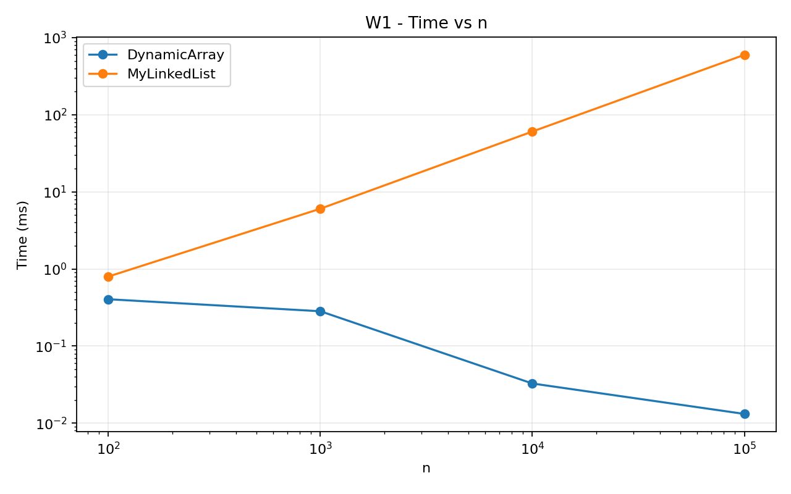
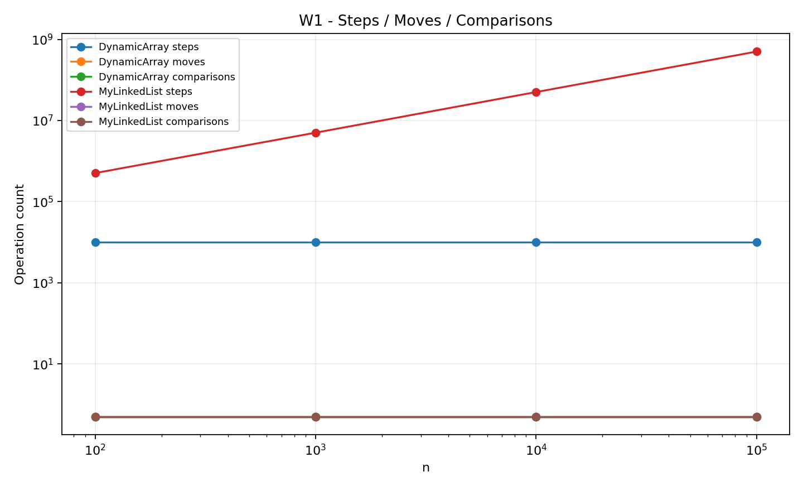
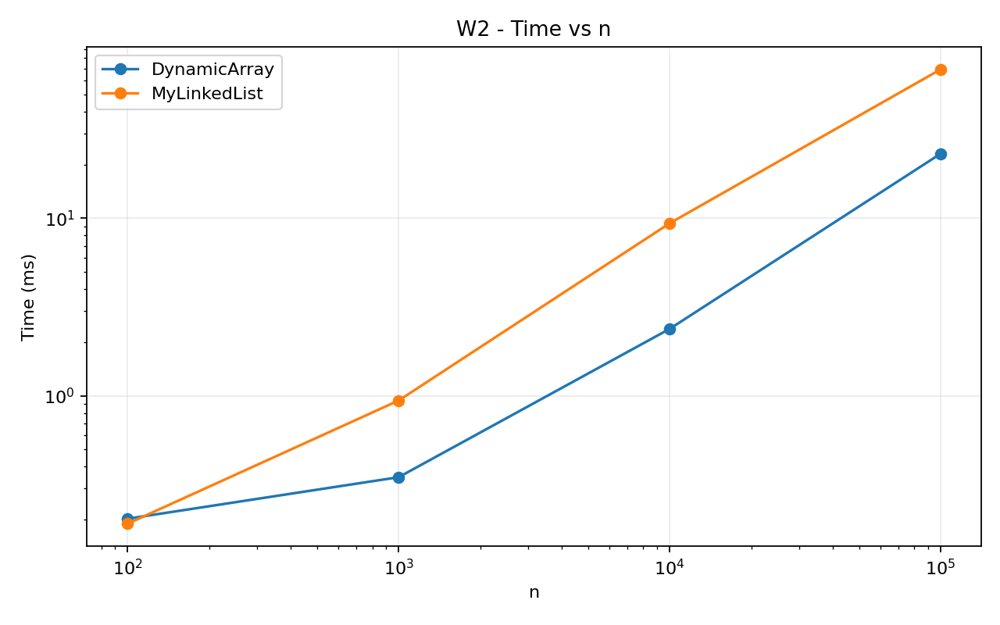
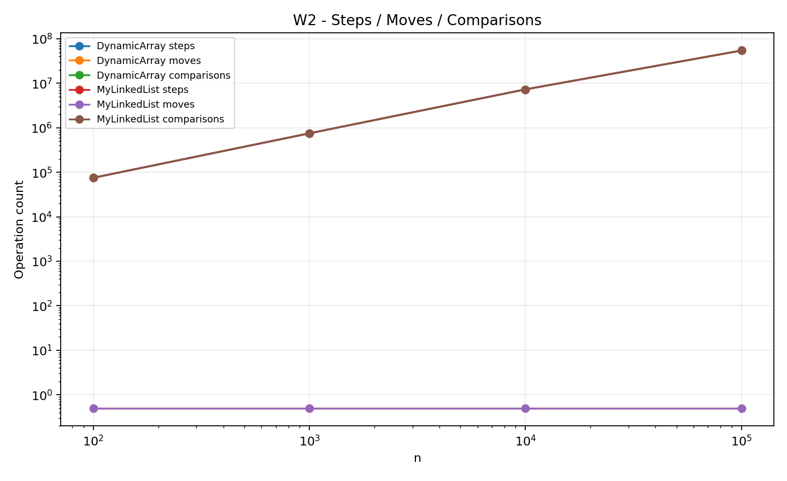
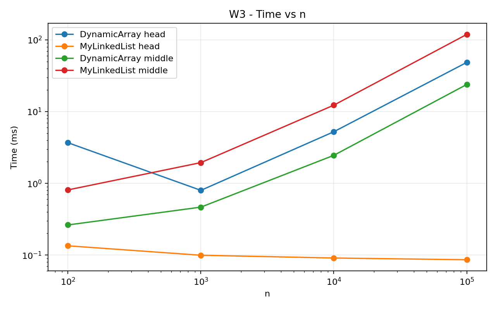
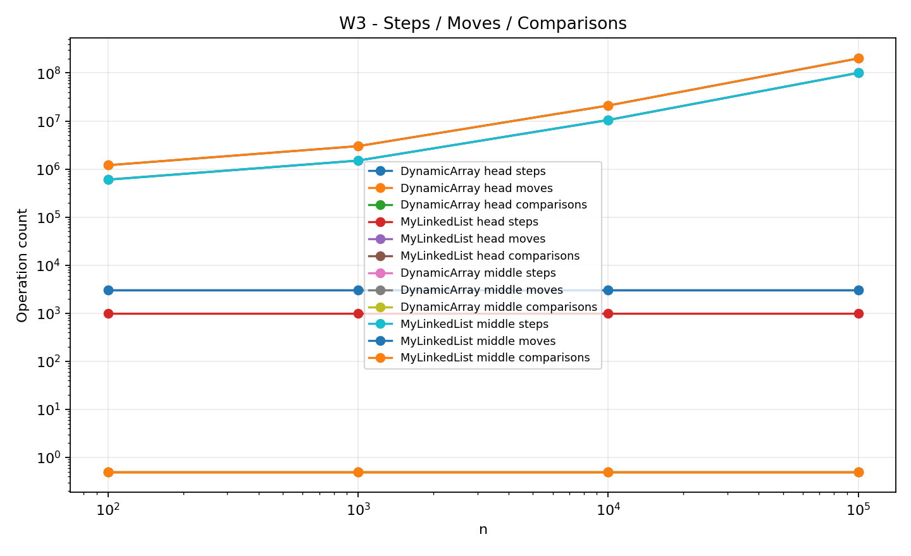
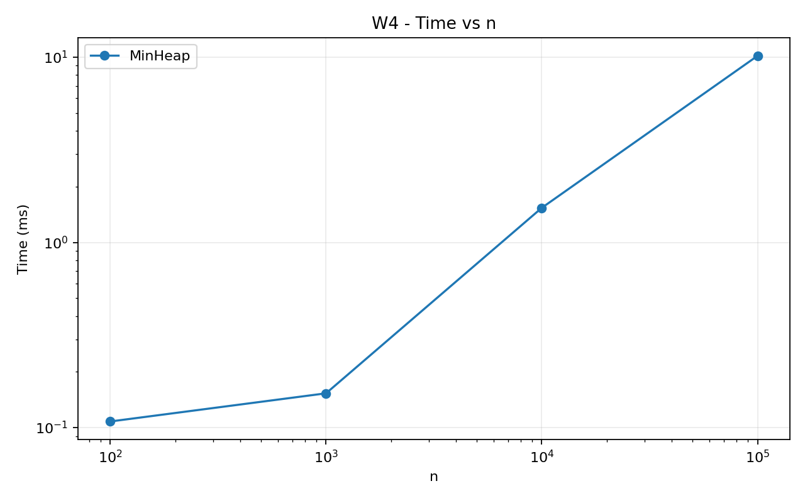
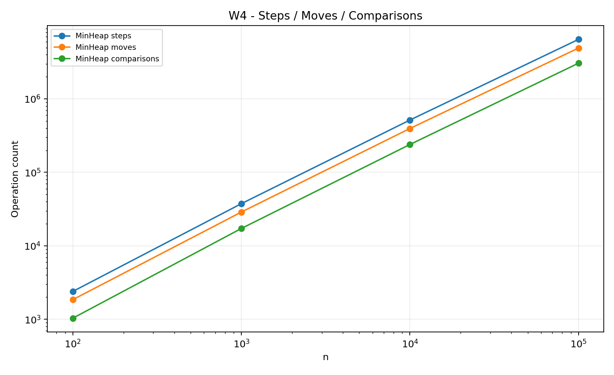

# Assignment 2 Report - Data Structures

**Student:** BALAGAZY ABYLAIKHAN

## 1. Complexity table

| Structure | Operation | Best | Average | Worst | Auxiliary space | Short reason |
|---|---|---:|---:|---:|---:|---|
| DynamicArray | add(x) | Θ(1) | Θ(1) amortized | Θ(n) | Θ(n) capacity | Usually writes at the end, but resize copies all elements. |
| DynamicArray | add(index,x) | Θ(1) | Θ(n) | Θ(n) | Θ(n) capacity | Elements after the index have to be shifted. |
| DynamicArray | remove(index) | Θ(1) | Θ(n) | Θ(n) | Θ(1) extra | Removing the last item is constant, other cases shift values. |
| DynamicArray | get(index) | Θ(1) | Θ(1) | Θ(1) | Θ(1) | Direct array indexing. |
| DynamicArray | contains(x) | Θ(1) | Θ(n) | Θ(n) | Θ(1) | Linear search can stop early or scan the full array. |
| MyLinkedList | add(x) | Θ(1) | Θ(1) | Θ(1) | Θ(1) per node | Tail pointer gives constant append. |
| MyLinkedList | add(index,x) | Θ(1) | Θ(n) | Θ(n) | Θ(1) | Head insertion is constant but other indexes need traversal. |
| MyLinkedList | remove(index) | Θ(1) | Θ(n) | Θ(n) | Θ(1) | Head removal is constant but other indexes need traversal. |
| MyLinkedList | get(index) | Θ(1) | Θ(n) | Θ(n) | Θ(1) | The list follows next pointers from the head. |
| MyLinkedList | contains(x) | Θ(1) | Θ(n) | Θ(n) | Θ(1) | Linear scan through nodes. |
| MinHeap | insert(x) | Θ(1) | O(log n) | Θ(log n) | Θ(n) capacity | Bubble-up may stop immediately or reach the root. |
| MinHeap | peekMin() | Θ(1) | Θ(1) | Θ(1) | Θ(1) | Minimum is stored at index 0. |
| MinHeap | extractMin() | Θ(1) | O(log n) | Θ(log n) | Θ(1) extra | After replacing the root, bubble-down may travel through heap height. |

## 2. Loop invariant proof 1 - DynamicArray.contains(x)

**Invariant.** Before every iteration with index `i`, none of the elements in positions `0` to `i-1` is equal to `x`.

**Initialization.** Before the first iteration `i=0`, there are no earlier elements, so the statement is true.

**Maintenance.** If `data[i]` is equal to `x`, the method returns `true`. If it is not equal, after the comparison we know positions `0` to `i` do not contain `x`, so the invariant is true for the next iteration.

**Termination.** If the loop finishes, `i=size` and all valid positions were checked without finding `x`, so returning `false` is correct.

**Conclusion.** The invariant shows that every element before the current index was already checked correctly. Therefore the method returns true exactly when the value exists.

## 3. Loop invariant proof 2 - MinHeap.extractMin bubble-down

**Invariant.** Before every bubble-down iteration, every part of the heap outside the current node `i` and its path is already a valid min-heap, and any possible heap violation is only between `data[i]` and one of its children.

**Initialization.** After the last element is moved to the root, the old subtrees are unchanged and are still valid heaps. Only the new root may be too large compared with its children.

**Maintenance.** The algorithm finds the smaller child. If the current value is already not larger, the heap is valid. Otherwise it swaps with the smaller child. The old position becomes valid, and the only possible new violation moves down to the new position of `i`.

**Termination.** The loop stops when there is no child or when `data[i]` is not greater than its smallest child. Then there is no remaining violation and the complete heap property holds.

**Conclusion.** Each swap fixes the current level and only moves the possible violation downward, so after termination the array is a correct min-heap.

## 4. Benchmark setup

All structures use the same integer data generated with `new Random(42)`. I used sizes 100, 1,000, 10,000 and 100,000. Each case has one warm-up run and then five measured runs. The CSV stores the median measured time. Steps, moves and comparisons are counted inside the data-structure methods.

The workloads are:

- W1: 10,000 random `get(index)` calls for DynamicArray and MyLinkedList.
- W2: 1,000 `contains(x)` calls, half present and half absent.
- W3: 1,000 insertions and 1,000 removals for both head and middle variants.
- W4: insert all values into MinHeap and then extract all values while checking non-decreasing order.

## 5. Plots

### W1 - Random Access

### W2 - Search

### W3 - Insert and Remove

### W4 - Priority Processing

## 6. Discussion

DynamicArray is much faster for `get(i)` because an array can calculate the address of an element directly. Its values are also stored next to each other in memory. This gives good spatial locality, so one CPU cache line can contain several useful integers. MyLinkedList has to follow one `next` pointer after another to reach an index. Those nodes can be stored in different memory locations, which causes pointer chasing and more cache misses. Because of this, even two operations with a similar Big-O can have noticeably different real running times. List nodes also need extra object data and references, while an `int[]` stores primitive values compactly. More node objects also give the garbage collector more objects to manage. For search, both structures are linear, but the array often has a smaller constant factor because it scans contiguous memory. For insertion and removal at the head, the linked list is better because only a small number of links change, while the array shifts many elements. In the middle, the list avoids shifting but still has to walk to the middle, so it is not automatically faster. DynamicArray is a good choice when random access and iteration are important. MyLinkedList is useful when changes near the head are very frequent and index access is not important. MinHeap is better for priority processing because the minimum is available at the root in constant time. Insert and extract are logarithmic, which makes the heap suitable for schedulers and priority queues.
